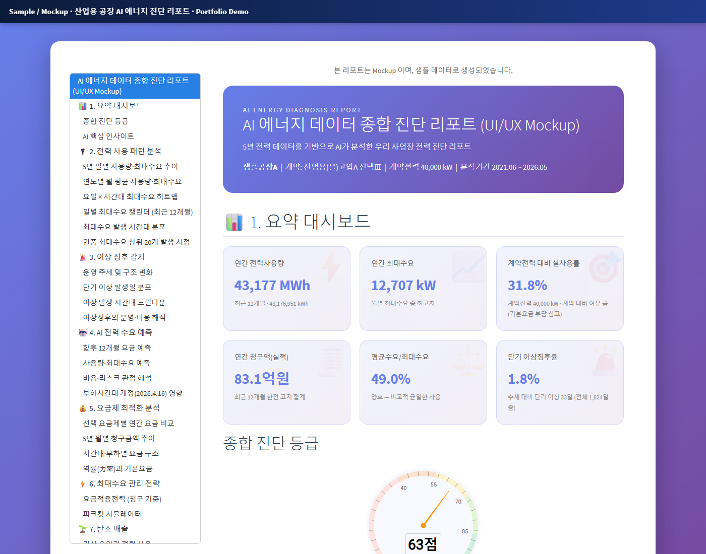
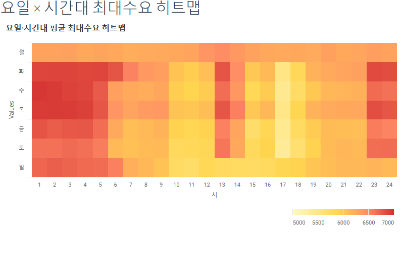
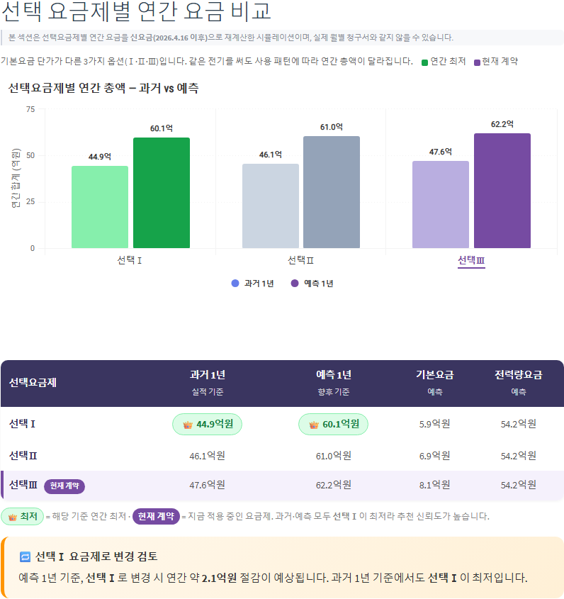
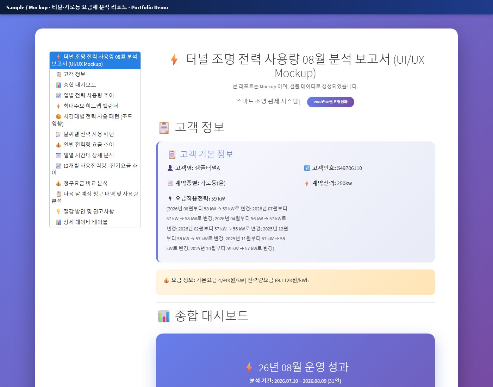
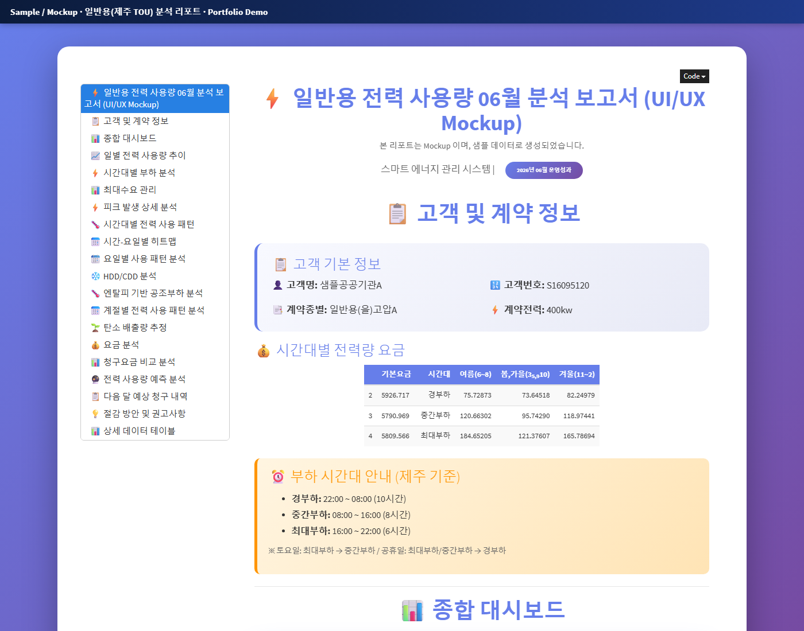

# 에너지 분석 리포트 샘플

한전 전력 데이터를 모아 만든 고객용 에너지 분석 리포트 3종입니다.  
공장 AI 진단, 터널 가로등 요금제, 공공기관 일반요금제 현장에 맞춰 구성을 다르게 잡았습니다.

고객명과 수치는 공개용으로 바꿨습니다. 화면 구성과 분석 흐름은 실제 업무 결과물과 같습니다.

**데모:** [https://bob-joosayo.github.io/portfolio-sample-reports/](https://bob-joosayo.github.io/portfolio-sample-reports/)

| 리포트 | 바로 보기 |
|---|---|
| AI 에너지 종합 진단 (산업용 공장) | [plant-a-ai-diagnosis.html](https://bob-joosayo.github.io/portfolio-sample-reports/plant-a-ai-diagnosis.html) |
| 터널 조명 전력 분석 (가로등 요금제) | [tunnel-a-streetlight.html](https://bob-joosayo.github.io/portfolio-sample-reports/tunnel-a-streetlight.html) |
| 일반용 전력 분석 (공공기관) | [agency-a-general-tariff.html](https://bob-joosayo.github.io/portfolio-sample-reports/agency-a-general-tariff.html) |

공장 리포트는 5년치 사용 패턴, 이상 징후, 수요와 요금 예측, 선택요금제 비교까지 한 파일에 담았습니다.  
이 진단이 고객 의사결정 자료로 쓰여 EMS 계약으로 이어진 케이스입니다.

| 최대수요 히트맵 | 선택요금제 비교 |
|---|---|
|  |  |

터널 리포트는 조도센서가 제대로 동작하는지 사용 패턴으로 판별하고,  
공공기관 리포트는 지역 부하시간대와 피크, 계절, 냉난방도일을 반영해 절감 포인트를 잡습니다.

| 터널 리포트 | 공공기관 리포트 |
|---|---|
|  |  |
