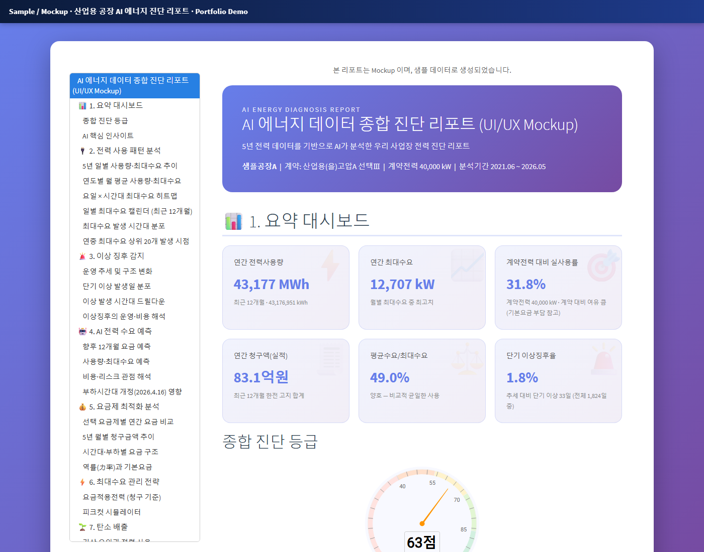
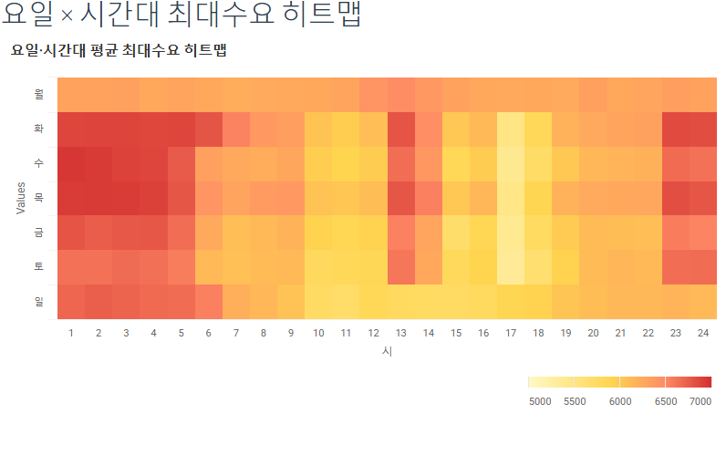
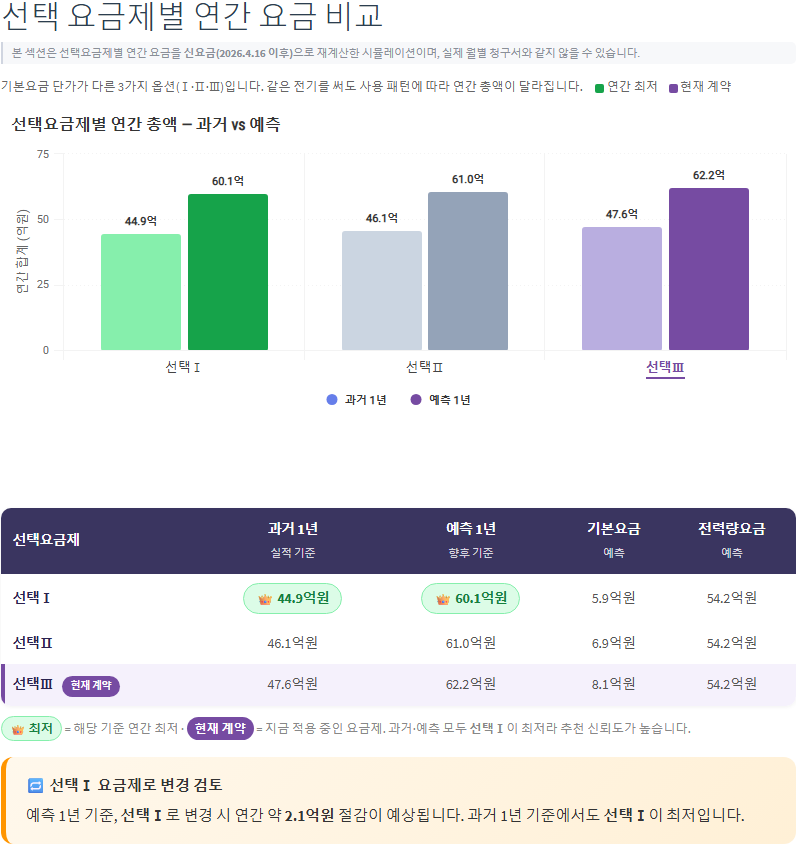
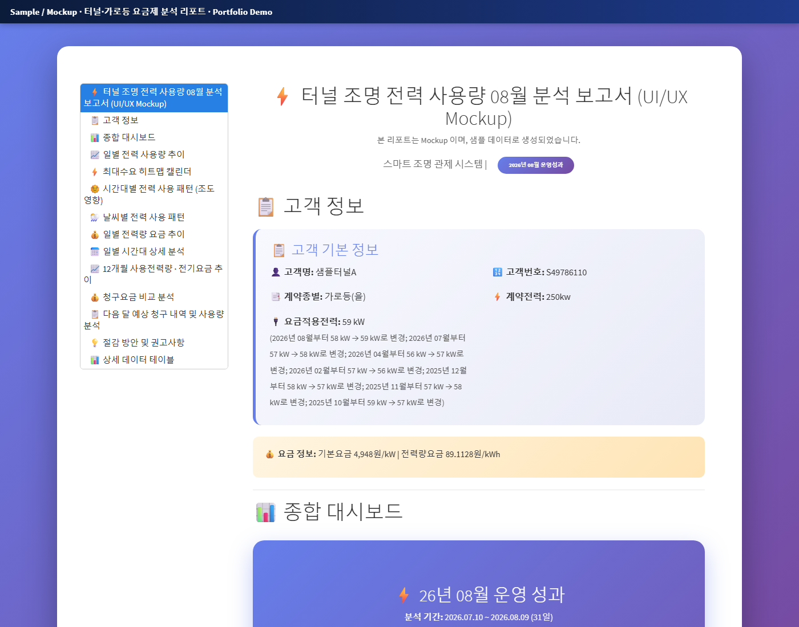
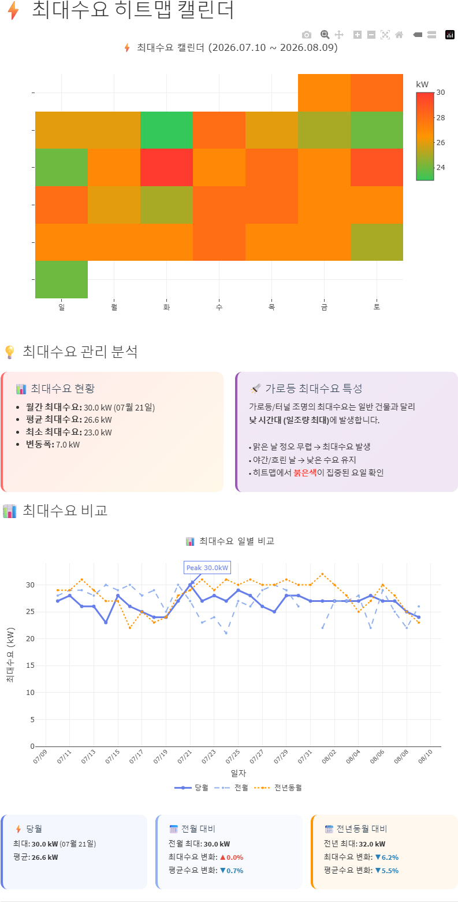
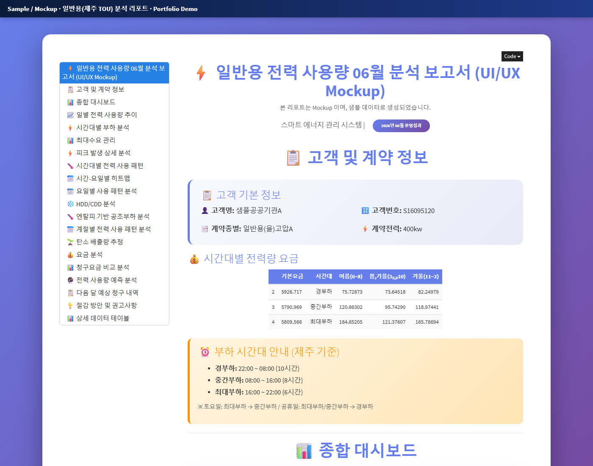
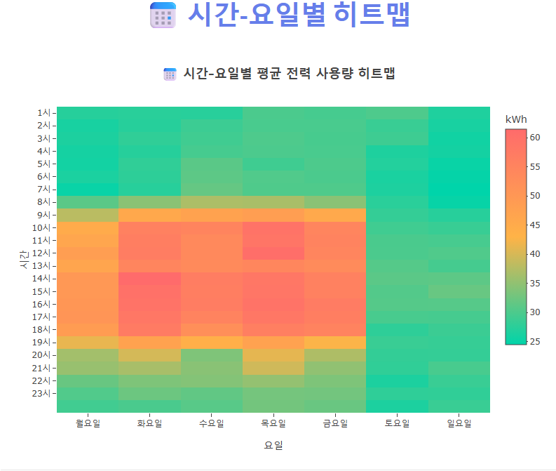

# Energy Analysis Reports (R Markdown HTML)

한전 전력 데이터를 수집해 고객사별로 만들어 온 **에너지 분석 리포트 3종의 익명화 샘플**입니다.
R Markdown 으로 만든 인터랙티브 HTML 이며, 실제 고객에게 제공하던 리포트 구조를 그대로 두고 고객명 · 고객번호 · 수치를 바꿨습니다.

> 고객명(샘플공장A · 샘플터널A · 샘플공공기관A), 고객번호, 사용량 · 요금은 모두 Mock / 스케일 조정 값입니다. 실제 고객 산출물이 아닙니다.

**라이브 데모:** https://bob-joosayo.github.io/portfolio-sample-reports/

| 리포트 | 대상 | 바로 보기 |
|---|---|---|
| AI 에너지 종합 진단 | 산업용 공장 (5년치 데이터) | [plant-a-ai-diagnosis.html](https://bob-joosayo.github.io/portfolio-sample-reports/plant-a-ai-diagnosis.html) |
| 터널 조명 전력 분석 | 가로등 요금제 터널 | [tunnel-a-streetlight.html](https://bob-joosayo.github.io/portfolio-sample-reports/tunnel-a-streetlight.html) |
| 일반용 전력 분석 | 지역 부하시간대를 적용받는 공공기관 | [agency-a-general-tariff.html](https://bob-joosayo.github.io/portfolio-sample-reports/agency-a-general-tariff.html) |

## 배경과 역할

| 항목 | 내용 |
|---|---|
| 데이터 | 한전 고객 포털에서 15분 · 시간 · 일 · 월 사용량, 최대수요, 청구 내역을 자동 수집 (API 대비 청구 원천에 가까워 정확도가 높음) + 기상청 기상 · 공휴일 데이터 결합 |
| 한 일 | 수집 → 요금 계산 엔진 → 분석 → R Markdown 리포트까지 전 과정 직접 개발, 현장 유형별로 리포트 구성을 따로 설계 |
| 성과 | 공장 AI 진단 리포트가 고객 의사결정 자료로 쓰여 **EMS 계약으로 연결** 됨. 터널 · 공공기관 리포트는 월간 정기 리포트로 운영 |

## 1. AI 에너지 종합 진단 (산업용 공장)

5년치 한전 데이터를 바탕으로 사용 패턴 → 이상 징후 → 수요 · 요금 예측 → 요금제 최적화 → 실행 과제 순으로 진단합니다.

- **요약 대시보드 · 종합 진단 등급**: 연간 사용량 · 최대수요 · 계약전력 대비 실사용률 · 부하율 · 단기 이상징후율을 한 화면에
- **사용 패턴**: 5년 일별 추이, 요일 × 시간대 최대수요 히트맵, 최대수요 캘린더, 상위 20개 피크 발생 시점
- **이상 징후**: 운영 추세 · 구조 변화 탐지, 단기 이상일 분포와 시간대 드릴다운, 비용 영향 해석
- **AI 예측**: 향후 12개월 사용량 · 최대수요 · 청구요금 예측, 부하시간대 개정(2026.4) 영향 분석
- **요금제 최적화**: 선택요금제(Ⅰ·Ⅱ·Ⅲ)별 과거 1년 · 예측 1년 연간 요금 비교와 변경 권고, 역률 · 기본요금 구조
- **기상 · 탄소**: 기온 민감도(냉난방 의존도), 대기 엔탈피와 최대수요, 탄소 배출량

| 요일 × 시간대 최대수요 히트맵 | 선택요금제별 연간 요금 비교 |
|---|---|
|  |  |

## 2. 터널 조명 전력 분석 (가로등 요금제)

조도센서로 밝기를 제어하는 터널 조명 현장입니다. 단순 사용량 집계가 아니라 **조도센서가 제대로 동작하는지** 를 사용 패턴으로 판별합니다.

- 주간(밝을수록 조명을 더 켬) · 야간 사용량 비교로 조도 제어 동작 확인
- 날씨별(맑음 · 구름조금 · 구름많음 · 흐림 · 비) 사용 패턴, 최대수요 히트맵 캘린더, 당월 · 전월 · 전년 동월 최대수요 비교
- 가로등 요금제 기준 일별 요금, 12개월 사용량 · 요금 추이, 청구요금 항목별 비교, 다음 달 예상 청구

| 터널 리포트 첫 화면 | 최대수요 캘린더 · 비교 |
|---|---|
|  |  |

## 3. 일반용 전력 분석 (공공기관)

일반용 요금제지만 지역 고유의 부하시간대(TOU)를 적용받는 사무용 건물입니다.

- 경부하 · 중간부하 · 최대부하 구간별 사용량 · 요금 구성, 피크 발생 시각 · 요일 분석
- 시간 × 요일 히트맵, 계절별 패턴, **HDD/CDD(냉난방도일) 와 밸런스 포인트**, 엔탈피 기반 공조부하 분석
- 사용량 예측, 다음 달 예상 청구, 절감 방안

| 리포트 첫 화면 | 시간 × 요일 사용량 히트맵 |
|---|---|
|  |  |

## 기술

- **R Markdown → self-contained HTML**: 파일 하나로 메일 · 메신저 공유 가능, 목차 고정 · 섹션 이동
- **시각화**: plotly · highcharter · ggplot2 (히트맵, 캘린더, 게이지, 예측 구간, 드릴다운)
- **요금 계산**: 한전 요금표(계약종별 · 선택요금 · 계절 · 부하시간대)를 그대로 계산하는 자체 요금 엔진으로 청구서와 검증
- **수집 · 결합**: RSelenium 으로 한전 고객 포털 자동 수집, 기상청 · 공휴일 공공 API 결합

## 관련 저장소

- [kepco-energy-analytics](https://github.com/BOB-joosayo/kepco-energy-analytics) — 이 리포트들의 데이터 수집 · 요금 엔진 · 분석 파이프라인 (R, 익명화 코드)
